

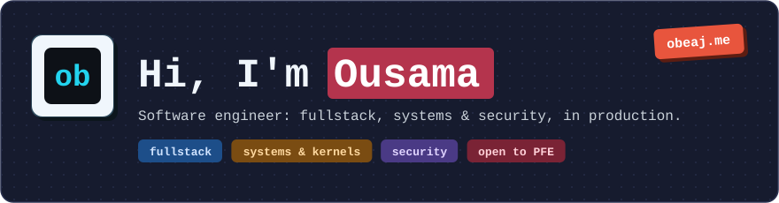

  


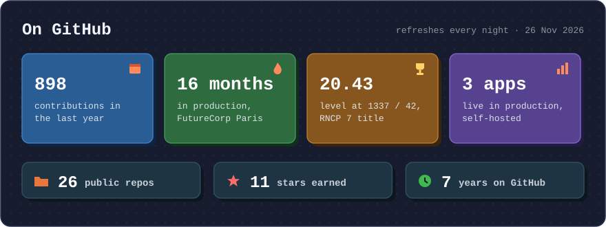


---


### Featured projects

  
  

  <a href="https://github.com/BEAJousama/red-tetris"></a>
  

### Systems, infrastructure & security

  
  

  <a href="https://github.com/BEAJousama/beaj-shell"></a>
  <a href="https://github.com/BEAJousama/websrv"></a>

  <a href="https://github.com/BEAJousama/BADASS"></a>
  <a href="https://github.com/BEAJousama/inception"></a>

More: <a href="https://github.com/BEAJousama/kfs_2">kfs_2</a> · <a href="https://github.com/BEAJousama/override">override</a> · <a href="https://github.com/BEAJousama/Cloud-I">Cloud-I</a> · <a href="https://github.com/BEAJousama/cv-builder">cv-builder</a> · <a href="https://github.com/BEAJousama/miniRT">miniRT</a> · <a href="https://github.com/BEAJousama/ft_containers">ft_containers</a>

---

### Tech

  
   
  

English (professional) · French (fluent) · Arabic (native)

---


 

