 

**🎯 Looking for a 6-month PFE internship — remote or on-site, available now**

---

### About

- **1.3 years of production experience** at [FutureCorp](https://futurecorp.paris) (digital studio, Paris, remote): main engineer on CMS-driven Next.js platforms for brands like **Beige Pill** and **Fleming Watch**, maintainer on sites for **Saatchi & Saatchi UK** and **The Brooklyn Tower**.
- **Final year at 1337 (42 Network)**, level 20, RNCP level 7 (master's level). I went deep on the layers underneath: an x86 kernel, a Unix shell, an HTTP server, binary exploitation, BGP-EVPN networks, Kubernetes with GitOps.
- I build full-stack systems end to end and **run them myself in production** on cloud VMs (Caddy/Nginx, TLS, Docker).

---

### Featured projects

  
  

  
  

### Systems, infrastructure & security

  
  

  
  

  
  

More: <a href="https://github.com/BEAJousama/kfs_2">kfs_2</a> · <a href="https://github.com/BEAJousama/override">override</a> · <a href="https://github.com/BEAJousama/Cloud-I">Cloud-I</a> · <a href="https://github.com/BEAJousama/cv-builder">cv-builder</a> · <a href="https://github.com/BEAJousama/miniRT">miniRT</a> · <a href="https://github.com/BEAJousama/ft_containers">ft_containers</a>

---

### Tech

  
   
  

English (professional) · French (fluent) · Arabic (native)

---

 

<picture>
  <source media="(prefers-color-scheme: dark)" srcset="https://raw.githubusercontent.com/BEAJousama/BEAJousama/output/snake-dark.svg" />
  <source media="(prefers-color-scheme: light)" srcset="https://raw.githubusercontent.com/BEAJousama/BEAJousama/output/snake.svg" />
  
</picture>
